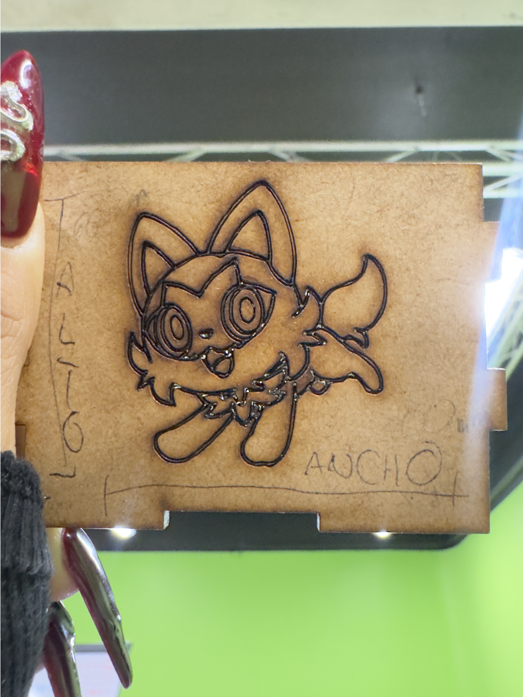
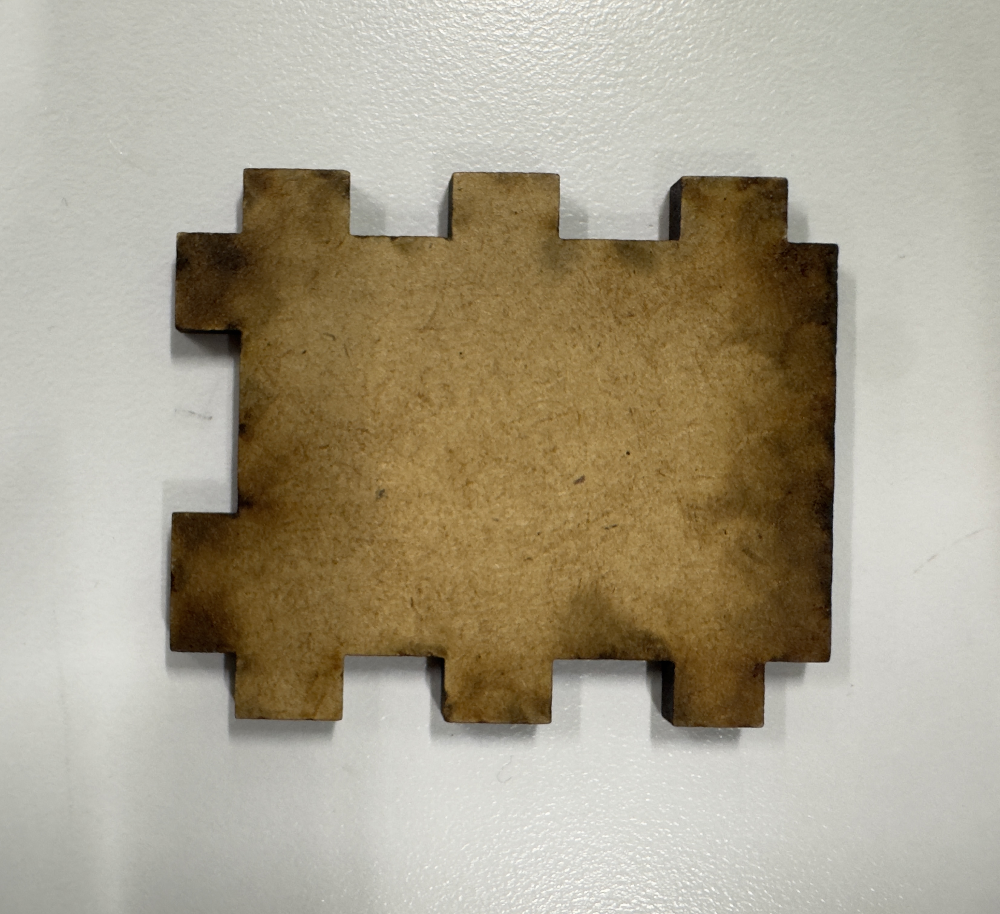

### **1. Espesor real del MDF**

- **Espesor real del MDF (medido con vernier):** **3.09 mm**

### **2. Valores de i parámetros**

- **Corte de Kerf inicial (sangría/ancho del haz de láser):** **0.20 mm** (en la consulta mencionaste `2.0`, pero en el diseño paramétrico estándar de ensamble y en las líneas de desfase del archivo DXF la medida compensada es de `0.20 mm` o `0.2 mm`).

#### **Dimensiones Generales de la Caja y Piezas***

- **Largo / Ancho base:** **80.00 mm**

- **Alto de caras laterales:** **60.00 mm**

- **Ancho / Profundidad de tapas y caras inferiores:** **50.00 mm**

- **Espesor del material (offset / desfase en acotaciones):** **3.00 mm**

#### **Medidas de Ensamble y Dientes (Almenas / Ranuras)**

- **Largo estándar de dientes/ensambles:** **12.50 mm**

- **Largo de dientes secundarios / secciones:** **10.00 mm**, **14.00 mm**, **16.00 mm** y **26.00 mm**

- **Ancho / Profundidad de ranura de ensamble:** **3.00 mm**

- **Separación / Ancho interno central entre encastres:** **24.00 mm** y **30.00 mm**

- **Separaciones menores:** **12.00 mm**

- **Desfase del eje x:** **0.119 mm**

#### **Qué fue lo más difícil**

Lo más complicado fue cuidar la orientación de los encastres macho y hembra. Tenía que estar súper atenta a cada detalle de las caras opuestas para que, al momento de armar la caja, todo coincidiera perfectamente y nada quedara al revés. En un intento por ahorrar tiempo quise usar Mirror y luego Rotate, pero me jugó un poco en contra. Al hacer el reflejo, las pestañas y ranuras se invirtieron y ya no ensamblaban en 3D. Me tomó algo de tiempo darme cuenta, pero me sirvió muchísimo para entender mejor cómo estructurar el diseño desde cero.

## Ahora si el corte laser!

### Primer intento
En el primer intento, la caja, tanto en bordes como en grabado, salía con quemaduras muy fuertes, debido a que este primer intento se hizo con base en un estándar.
#### Corte

| Parametros |       |
| ---------- | ----- |
| Max Power  | 85.00 |
| Min Power  | 80.00 |
| Speed      | 40.00 |

Aquí se podría decir que el error que se tuvo fue que hubo mucha potencia y una velocidad muy baja, por lo cual se quemó bastante; el kerf, en cuanto a diseño e implementación, salía diferente y las piezas quedaron muy sueltas.

#### Gravado

| Parametros |        |
| ---------- | ------ |
| Max Power  | 40.00  |
| Min Power  | 30.00  |
| Speed      | 800.00 |
De igual forma, en el grabado se quemó demasiado; incluso cortaba en el grabado.

### Segundo intento
En este segundo intento ya se bajo la potencia del laser pero se mantuvo la velocidad de 800 en ambos campos 
#### Corte

| Parametros |       |
| ---------- | ----- |
| Max Power  | 70.00 |
| Min Power  | 65.00 |
| Speed      | 40.00 |

Ahora si bien ya se podia notar un cambió en el grabado y en que las piezas ahora si embonaban, seguia habiendo una buena area de quemado. 

#### Gravado

| Parametros |        |
| ---------- | ------ |
| Max Power  | 35.00  |
| Min Power  | 30.00  |
| Speed      | 800.00 |
De igual forma, en el grabado se quemó un poco en los bordes, dejando poco clara la imagen o con bordes "borrosos.

![[IMG_4820.jpg]]

![[IMG_4819.jpg]]

### Tercer intento
Ahora, ya con más experiencia, en el tercer intento se bajó la velocidad y la potencia se subió un poco con la hipótesis de que marcaría más el trazo pero sin traspasar el material. Aquí fue donde ya se vio el primer cambio. ¿Qué efecto tuvo? Pues veamos.
#### Corte

| Parametros |       |
| ---------- | ----- |
| Max Power  | 72.00 |
| Min Power  | 60.00 |
| Speed      | 13.00 |
Se corta, que es el punto, pero el problema está en que aún se veía una buena área quemada, y esas quemaduras se presentan como manchas cafés en los bordes.

#### Gravado

| Parametros |        |
| ---------- | ------ |
| Max Power  | 30.00  |
| Min Power  | 20.00  |
| Speed      | 200.00 |
Parecía casi bueno, aún conservaba pequeños detalles en algunos vértices, ya que se veía demasiado quemado; igual la línea se sentía gruesa y se perdían detalles.

![[IMG_4823.jpg]]

![[IMG_4825.jpg]]

### Cuarto intento
Ahora, si bien ya teníamos así el corte perfeccionado, el grabado aún dejaba mucho que desear; por ello es que se bajaron las potencias un poco más aún.
#### Corte

| Parametros |       |
| ---------- | ----- |
| Max Power  | 55.00 |
| Min Power  | 50.00 |
| Speed      | 30.00 |

Mayormente, aquí se bajaron potencias y se aumentó un poco la velocidad, dando un resultado que sorprende bastante; solo dejó un pequeño borde café claro imperceptible.

#### Gravado

| Parametros |        |
| ---------- | ------ |
| Max Power  | 15.00  |
| Min Power  | 8.00   |
| Speed      | 200.00 |
Ahora sí con todo, realmente ya se podían apreciar a la perfección los detalles y bordes sin puntos más quemados y sin ese efecto borroso.

![[IMG_4827.jpg]]

![[IMG_4826.jpg]]

### Intento Especial
Si bien ya salía perfecto, quería experimentar un poco qué pasaría cuando el material cambiaba, con un grosor inicial de tres milímetros, pero sin medirlo; es decir, variaba por decimales solamente, usando los mismos parámetros de la otra vez
#### Corte

| Parametros |       |
| ---------- | ----- |
| Max Power  | 72.00 |
| Min Power  | 60.00 |
| Speed      | 13.00 |

#### Gravado

| Parametros |        |
| ---------- | ------ |
| Max Power  | 30.00  |
| Min Power  | 20.00  |
| Speed      | 200.00 |

Bueno, como podemos ver, el borde solo aumentó un poco, es decir, se engrosó un poco, mínimamente. En cuanto al grabado, se puede observar casi igual, incluso se podría decir que más limpio. Lo curioso aquí está en que ahora las piezas no embonaban de una manera en que no se cayeran o separaran al mínimo movimiento, es decir, que el kerf aumentó demasiado, aunque fueran casi igual, solo unos milímetros de diferencia.

![[Pasted image 20261021104507.png]]

![[Pasted image 20261021104523.png]]

Finalmente, se podría concluir que para lograr la perfección o un resultado esperado se requiere de mucha práctica, conocimiento y errores. Hubo partes donde me frustré de estar tanto tiempo en el área de cortadoras láser, pero la verdad es que el resultado no me decepcionó. Aprendí muchísimo en este tiempo: cómo usar una cortadora láser, protocolos de seguridad, editar en el mismo programa, así como usar Fusion, Inkscape y demás. Realmente, pese a que tuve muchos errores, siento que el conocimiento que adquirí y la emoción son algo por lo que valió totalmente la pena.

## Finalización 

Finalmente se podría decir que en este proyecto se logro aprender bastante  en canto a corte láser, diseño y sobre todo paciencia y que sobre los errores siempre se puede aprender, al final no puede haber un triunfo ni perfección sin errores 

![[IMG_4831.jpg]]
![[Screenshot 2026-10-22 at 2.39.31 p.m..png]]![[Screenshot 2026-10-22 at 2.39.48 p.m..png]]![[Screenshot 2026-10-22 at 2.40.20 p.m..png]]